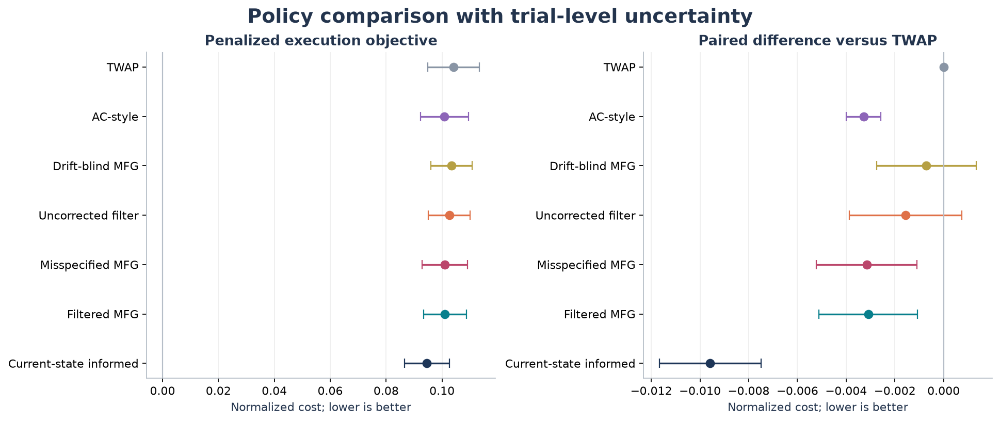
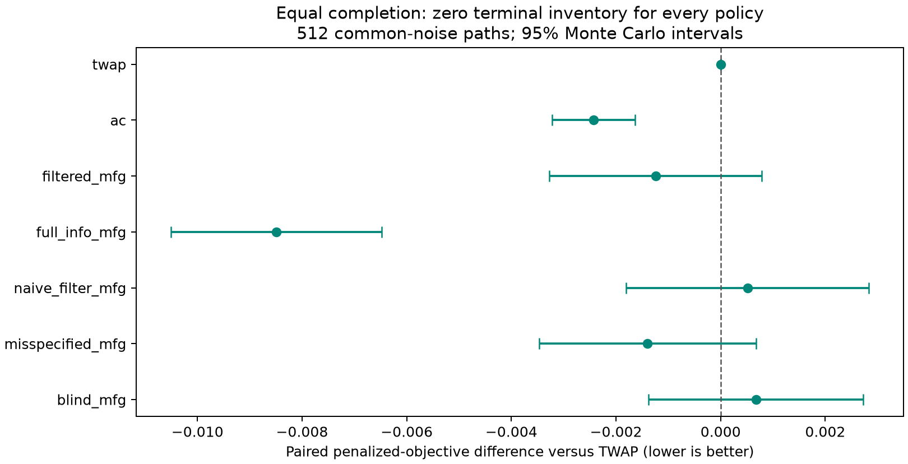
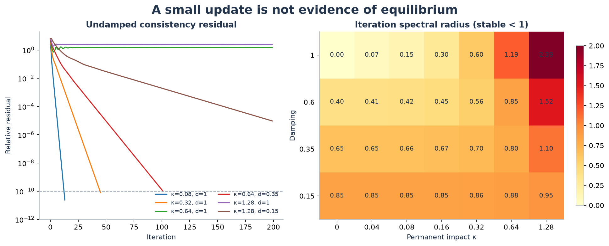
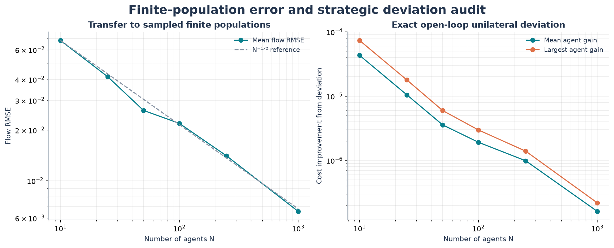

# Does Modeling Competing Traders Improve Optimal Execution?

**When does a computed execution equilibrium deserve to be trusted?**

An original Python research implementation of heterogeneous execution games with
latent market regimes. It connects exact quadratic best responses, auditable
mean-field consistency, causal filtering, and finite-player deviation tests in one
reproducible experiment suite.

The main contribution is an **equilibrium audit**: a strategy is evaluated against
an independent linear-system solution, an undamped consistency residual, and the
gain available to a finite agent that deviates while its peers keep their plans.
This makes convergence failures and finite-population approximation error visible.



**[Read the executed research report](results/published/report.md)** ·
**[Equal-completion supplement](results/hard_liquidation/REPORT.md)** ·
**[Derivation](docs/methodology.md)** ·
**[Walkthrough notebook](notebooks/research_walkthrough.ipynb)** ·
**[Limitations](docs/limitations.md)**

## Research questions

1. Does a damped best-response iteration reach an actual equilibrium, or merely
   take small steps? An exact affine-system solution provides a numerical reference.
2. How much does treating one's own price impact as exogenous drift distort a
   latent-state posterior and the resulting execution policy?
3. When a mean-field policy is transferred to a finite population, how far is its
   aggregate flow from the limit and how much can an individual gain by deviating?
4. Are policy comparisons stable under changes in coupling and observation noise?

## What is implemented

| Component | Implementation | Verification |
|---|---|---|
| Execution objective | Temporary impact, permanent aggregate impact, running inventory risk; soft terminal penalty or exact zero terminal inventory | Cash/marked-inventory identity and completion checked |
| Best response | Exact linear-quadratic solve; KKT equality projection for hard completion | Analytic edge cases, finite-difference gradient, independent unconstrained/constrained optimizers |
| Mean field | Heterogeneous population consistency; damped iteration and independent direct solve | Residual history, spectral radius, failed iterations retained |
| Latent regimes | Two-state Markov drift; Gaussian observation filter | Explicit predict/update timing, impact correction, prefix-causality tests |
| Policies | TWAP, AC-style, filtered MFG, current-state informed MFG, uncorrected, misspecified, drift-blind | Common exogenous paths across each paired comparison |
| Finite populations | Random types and initial inventories; exact unilateral open-loop deviation, with optional completion equality | Own 1/N permanent impact internalized; convexity and feasibility checked |
| Evaluation | 512 paths × 7 policies; 768 finite populations; 15 sensitivity cells × 64 paths × 4 policies; separate 512-path hard-completion supplement | Trial-level CSVs, 95% intervals, seeds, source and artifact hashes |

These are **synthetic, normalized execution experiments**. No empirical calibration,
market-data backtest, live execution, or investment-return result is claimed.

## Equal completion changes the conclusion

The default study uses a soft terminal penalty. A separately labeled extension
requires **every policy to finish at zero inventory**, with an exact equality
constraint rather than a large penalty or a forced final trade. All seven policies
are evaluated on 512 additional common-noise paths.

| Hard-completion comparison | Mean penalized-objective difference | Paired 95% interval |
|---|---:|---:|
| Filtered MFG minus TWAP | -0.001241 | [-0.003270, 0.000788] |
| Filtered MFG minus AC-style | +0.001190 | [-0.000126, 0.002505] |
| AC-style minus TWAP | -0.002431 | [-0.003223, -0.001638] |

Under equal completion, the filtered policy does **not establish an improvement
over TWAP**. The simpler AC-style policy has a lower mean objective than filtered
MFG, but that paired difference also spans zero. AC-style improves the penalized
objective relative to TWAP on this experiment. These are model-conditional,
pointwise Monte Carlo comparisons; a lower penalized objective need not mean lower
unpenalized execution shortfall. The original soft-terminal results remain available.



## Reproduce

Python 3.10 or newer:

```bash
python -m venv .venv
source .venv/bin/activate
python -m pip install -e '.[dev]'
pytest -q

# Short end-to-end run with all study types.
meanfield-execution --profile quick --output results/quick

# Reproduce the published tables and figures.
meanfield-execution --profile full --output results/reproduced

# Reproduce the separately labeled exact-completion supplement.
python scripts/hard_liquidation_study.py

ruff check src tests scripts
```

The package also runs without an editable installation:

```bash
PYTHONPATH=src python -m meanfield_execution --profile full --output results/reproduced
```

The full profile uses 40 decision intervals. The quick profile uses 24 intervals
and fewer trials, so its numerical results are deliberately different. Runtime
and dependency versions for the committed full run are in
[`manifest.json`](results/published/manifest.json). Floating-point differences
between BLAS implementations can change final digits; the report's sampling
uncertainty is far larger than those differences.

```python
import numpy as np
from meanfield_execution import MarketConfig, default_types, EquilibriumSystem, fixed_point

market = MarketConfig()
types = default_types()
system = EquilibriumSystem(types, market.steps, market.dt, market.permanent_impact)
inventory = [agent.initial_inventory for agent in types]
forecast = np.zeros(market.steps)

reference_flow, plans = system.solve(inventory, forecast)
iteration = fixed_point(system, inventory, forecast, damping=0.6)
print(iteration.converged, iteration.residuals[-1])
```

To require zero terminal inventory, set the type-level option before constructing
the equilibrium or calling `simulate`:

```python
from dataclasses import replace
from meanfield_execution import simulate

hard_types = tuple(replace(agent, terminal_penalty=0, hard_liquidation=True)
                   for agent in default_types())
result = simulate(types=hard_types, strategy="filtered_mfg", seed=510000)
print(result.inventories[-1])  # zero up to floating-point precision
```

## Model in one page

Selling is positive. Agent inventory evolves as

$$q_{t+1}^{k}=q_t^k-v_t^k\Delta t,$$

and the population mean selling rate is $m_t=\sum_k w_k v_t^k$.
The fundamental and impacted price increments are

$$\Delta F_t=a_{z_t}\Delta t+\sigma\sqrt{\Delta t}\,\epsilon_t,
\qquad \Delta S_t=\Delta F_t-\kappa m_t\Delta t.$$

An agent sells at $S_t-\eta_k v_t^k$. Given a deterministic drift forecast
$h_t=\widehat a_t-\kappa m_t$, its best response minimizes

$$J_k(v;m)=\eta_k\Delta t\sum_t v_t^2+
\phi_k\Delta t\sum_t q_{t+1}^2+A_kq_T^2
-\Delta t\sum_t q_{t+1}h_t.$$

The post-trade inventory in the last term follows from exact discrete
cash-and-inventory accounting. The derivation matters: changing the execution
timing while keeping the same objective creates an off-by-one economic model.

For partial information, the observation update first removes the known permanent
impact. Future planning uses the current belief and transition matrix, without
reading future prices or true states. At every step, a new deterministic
conditional-mean equilibrium is solved on the remaining horizon.

**Scope:** that receding-horizon policy is a certainty-equivalent approximation.
It is not a reproduction of the continuous-time stochastic FBSDE solution in the
source literature. Likewise, the finite-player audit covers deterministic
open-loop deviations and does not establish an adaptive epsilon-Nash theorem.

## Read the evidence





- [`results/published/trials.csv`](results/published/trials.csv): one policy/path row,
  including shortfall decomposition, terminal inventory, turnover, buyback frequency,
  filtering scores and accounting residual.
- [`results/published/convergence_summary.csv`](results/published/convergence_summary.csv):
  direct-solver error, consistency residual, convergence flag and iteration spectral radius.
- [`results/published/finite_population.csv`](results/published/finite_population.csv):
  finite-population flow error and exact deterministic deviation gains.
- [`results/published/sensitivity.csv`](results/published/sensitivity.csv): every trial
  in the prespecified impact/noise grid, including unflattering outcomes.
- [`results/hard_liquidation/trials.csv`](results/hard_liquidation/trials.csv): all
  policy/path results under the shared exact-completion constraint.
- [`docs/data_dictionary.md`](docs/data_dictionary.md): units, timing, uncertainty,
  and interpretation of every output.

## Design choices worth challenging

- Signed rates allow temporary buybacks and short positions; no participation cap
  or limit-order fill model is implied.
- The default study uses a finite terminal penalty and reports residual inventory.
  The hard-completion supplement applies the same terminal equality to every policy.
  Both permit signed rates; neither imposes participation limits or inventory bounds.
- All agents share the same public observation stream and filter specification within
  each experiment. Heterogeneity is in inventory, execution friction, and risk preference.
- Aggregate flow and the impact coefficient are known to the correctly specified
  filter. This is a strong information assumption, explicitly stressed by misspecification.
- Common price noise couples agents. Confidence intervals use independent complete
  paths, not the many correlated observations within one path.

## Repository map

```text
src/meanfield_execution/
  optimization.py   exact best responses and finite-player self-impact
  equilibrium.py    direct reference and residual-audited fixed point
  filtering.py      causal impact-corrected HMM
  simulation.py     paired stochastic execution and cash accounting
  population.py     finite-population / unilateral-deviation audit
  experiments.py    prespecified studies, retained data, report and manifest
  plotting.py       six reproducible research figures
scripts/            exact-completion supplement and its generated report
tests/              analytic, numerical, accounting and causality checks
docs/               derivation, limitations, provenance, interview guide
notebooks/          an executable walkthrough of the research
results/published/  the full executed study, not screenshots of invented results
results/hard_liquidation/ separately labeled equal-completion results
```

## Research provenance

This is a new implementation inspired by the execution-game setting of
[Casgrain and Jaimungal](https://arxiv.org/abs/1803.04094) and their
[SIAM exposition](https://www.siam.org/publications/siam-news/articles/algorithmic-trading-in-competitive-markets-with-mean-field-games/).
The mathematical setting is established literature; the audit design and implementation
are this repository's contribution, not a claim that mean-field execution is a new field.
The implementation was checked with analytic
benchmarks, independent numerical minimization, invariants, and seeded experiments.

See [references and provenance](docs/references.md) and the
[research discussion guide](docs/interview_guide.md). MIT-licensed original code.

