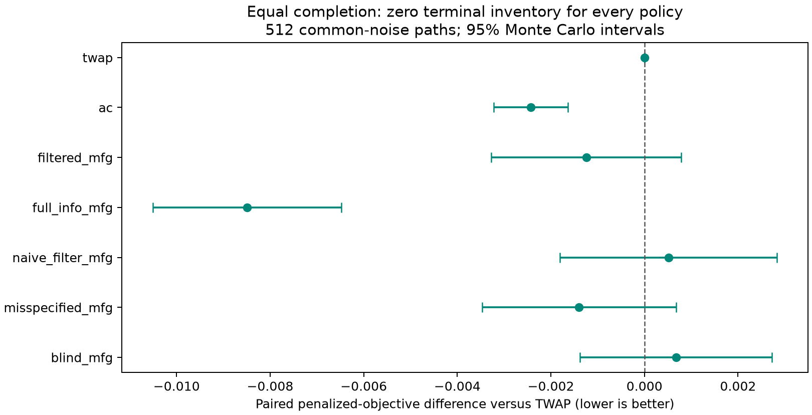

# Equal-completion supplement

All policies must finish at zero inventory, up to floating-point precision.
This is a separately labeled extension after the initial soft-terminal study,
not a replacement of unfavorable results. All 512 paths and seven policies are retained.

| Strategy | Paired objective difference vs TWAP | 95% interval |
|---|---:|---|
| twap | 0.000000 | [0.000000, 0.000000] |
| ac | -0.002431 | [-0.003223, -0.001638] |
| filtered_mfg | -0.001241 | [-0.003270, 0.000788] |
| full_info_mfg | -0.008493 | [-0.010503, -0.006483] |
| naive_filter_mfg | 0.000515 | [-0.001803, 0.002834] |
| misspecified_mfg | -0.001397 | [-0.003470, 0.000675] |
| blind_mfg | 0.000674 | [-0.001379, 0.002726] |

## What equal completion establishes

Filtered-minus-TWAP is **-0.001241**, with paired 95% interval **[-0.003270, 0.000788]**. The interval spans zero, so this setting does not establish a filtered-policy improvement.

The simpler AC-style policy has the lower mean penalized objective. Filtered-minus-AC is **0.001190**, with interval **[-0.000126, 0.002505]**; this difference also spans zero. The AC-style versus TWAP interval is negative in this experiment. These are pointwise Monte Carlo intervals, not simultaneous guarantees.

A lower penalized objective is not necessarily lower execution shortfall. Raw shortfall and turnover are retained in the trial and summary files.

## Constraint and diagnostic semantics

Every type uses `hard_liquidation=True` and zero terminal penalty. An exact KKT projection enforces the equality at every planning horizon; it is not a large-penalty approximation or a forced last-period adjustment. Rates remain signed, without inventory or participation bounds. The stochastic policy remains a certainty-equivalent receding-horizon approximation.

`decision_brier` is zero for current-state informed, equals the causal prior score for the three filter-driven policies, and is unavailable for TWAP, AC-style, and drift-blind. `filter_prior_brier` and `posterior_brier` always describe the auxiliary filter, including when a planner ignores it.

See [the KKT derivation](../../docs/methodology.md) and [the original soft-terminal study](../published/report.md).

