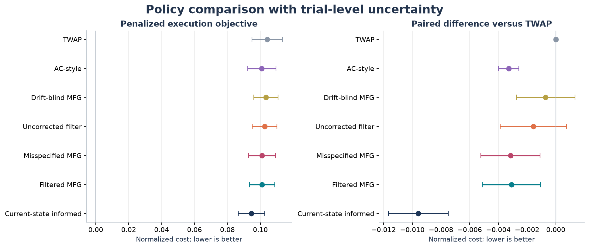
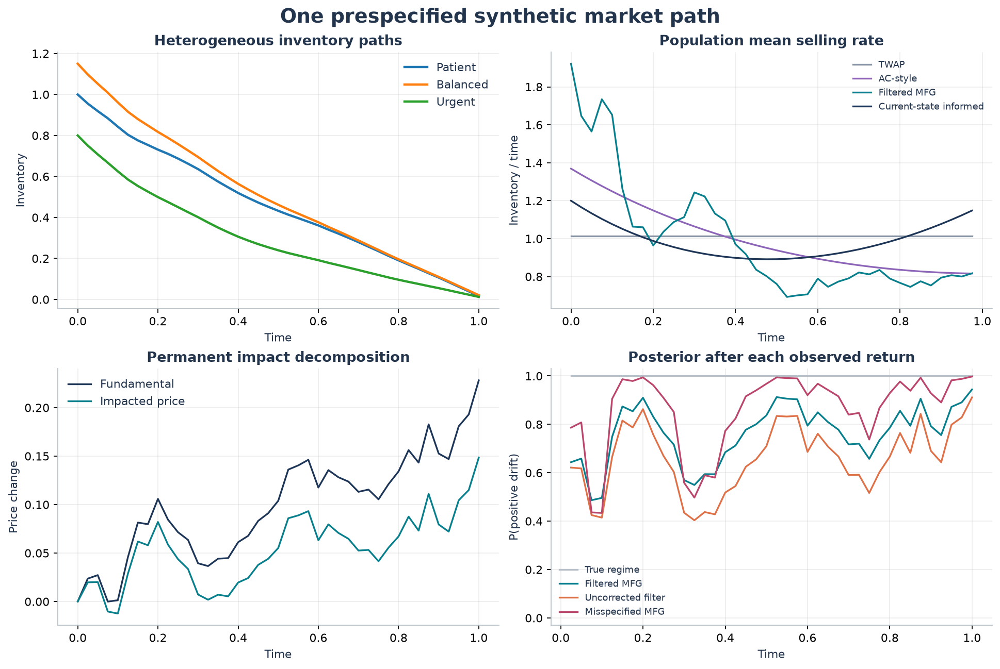
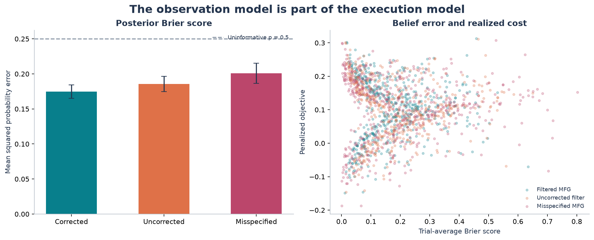
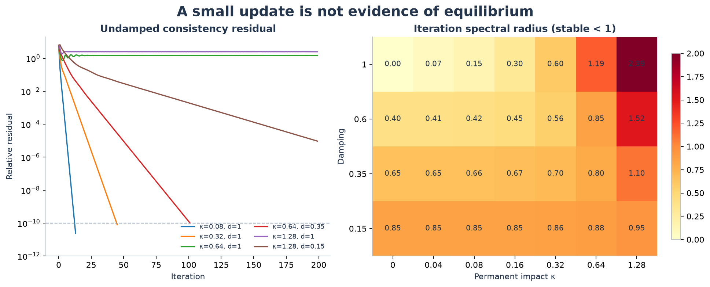
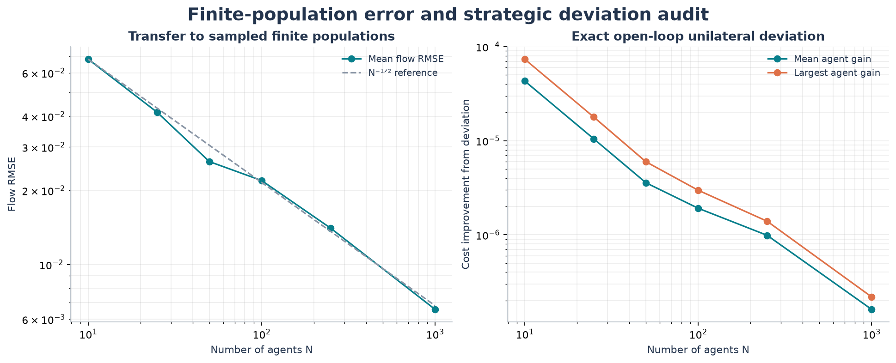
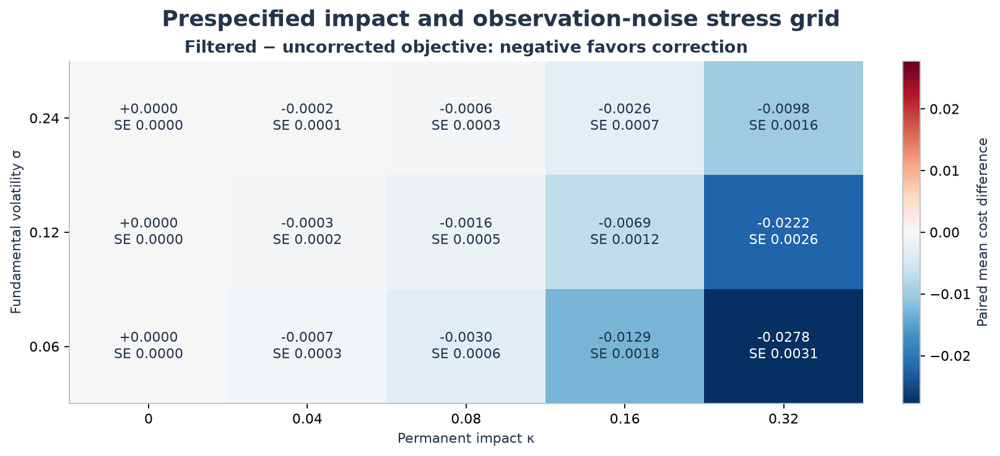

# Research results — auditable execution games

This report is generated by the experiment runner from retained trial-level CSV files.
All data are simulated under the documented model. Numbers are normalized objective
units, not dollars, basis points, investment returns, or empirical trading profits.

## Run

- Profile: `full`; 512 independent common-noise paths.
- Grid: 40 decisions over one normalized horizon.
- Seed: `20261117`. Every strategy in a trial sees the same fundamental path.
- The full configuration, package versions, runtime, and output hashes are in `manifest.json`.
- Confidence intervals are two-sided 95% Student-t intervals across independent paths.
  They describe Monte Carlo uncertainty conditional on the chosen simulator, not model uncertainty.

## Does strategic execution improve the chosen objective?

Lower objective is better. The objective includes marked implementation shortfall,
running inventory penalties and a terminal residual-inventory penalty. TWAP fully
liquidates; the other policies have a soft terminal objective, so residual inventory
is explicitly retained and charged. This is not an apples-to-apples hard-liquidation claim.

| strategy | mean | 95% interval |
| --- | --- | --- |
| twap | 0.104121 | [0.094889, 0.113353] |
| ac | 0.100843 | [0.092273, 0.109413] |
| filtered_mfg | 0.101030 | [0.093371, 0.108689] |
| full_info_mfg | 0.094543 | [0.086522, 0.102564] |
| naive_filter_mfg | 0.102560 | [0.095088, 0.110032] |
| misspecified_mfg | 0.100970 | [0.092811, 0.109129] |
| blind_mfg | 0.103418 | [0.096034, 0.110802] |

Paired differences against TWAP use each path as its own control:

| strategy | mean | 95% paired interval |
| --- | --- | --- |
| twap | 0.000000 | [0.000000, 0.000000] |
| ac | -0.003278 | [-0.003989, -0.002567] |
| filtered_mfg | -0.003091 | [-0.005118, -0.001065] |
| full_info_mfg | -0.009579 | [-0.011665, -0.007493] |
| naive_filter_mfg | -0.001562 | [-0.003873, 0.000750] |
| misspecified_mfg | -0.003152 | [-0.005219, -0.001084] |
| blind_mfg | -0.000704 | [-0.002747, 0.001340] |

The filtered policy's mean difference is **-0.003091** with interval
**[-0.005118, -0.001065]**. This result is conditional on
the risk and impact parameters. A lower penalized objective need not imply lower
unpenalized shortfall. The full-information policy sees the current regime only,
not future states or noise. It is an information benchmark implemented with the
same receding-horizon approximation, not a certified lower bound on achievable cost.

The filtered policy **does not establish superiority over the simpler AC-style
baseline**: its paired difference is 0.000187, with interval
[-0.001215, 0.001589]. Against the uncorrected filter,
the paired difference is -0.001530, with interval
[-0.001865, -0.001195]. These comparisons are
retained even when additional model complexity fails to improve cost.

## Why causal impact correction matters

A seller's own population depresses observed prices. Treating that movement as
exogenous alpha changes regime beliefs. The correct filter subtracts known
permanent impact before the Gaussian observation update. The naive policy omits
this correction; the misspecified policy halves assumed impact, reduces assumed
volatility to 65%, and makes regimes four times more persistent per discrete step.
The latter is a combined stress and cannot identify the contribution of each error.

The posterior Brier score measures the auxiliary filter after each interval.
The three filter-driven policies trade using its causal prior. `filter_prior_brier`
preserves that auxiliary prior diagnostic for all strategies; `decision_brier`
instead scores actual planner information. It is zero for the current-state-informed
policy and unavailable for TWAP, AC-style, and drift-blind policies, which do not
use regime probabilities. The stored `beliefs` and `posteriors` arrays remain
auxiliary-filter diagnostics. The example is the prespecified seed, not a selected
best path.

## Does the fixed point actually converge?

Every best response solves a strictly convex quadratic program in closed form.
The mean-flow map is affine, which supplies an independent dense linear-system
reference. Iteration stops on the undamped consistency residual, not the damped
step size. Across the prespecified coupling/damping grid,
**23/28** cases reached tolerance
within 200 iterations. Failures are retained in `convergence_summary.csv`.
The iteration matrix's spectral radius explains local/global stability of this
affine map; it is not a general convergence theorem for nonlinear MFGs.

## What survives a finite population?

For each population size, 128 independent populations
are sampled from the same heterogeneous type distribution. Initial holdings have
bounded mean-zero variation. Each agent applies the limiting open-loop schedule
using its own inventory. We measure mean-flow sampling error and compute every
agent's exact unilateral optimum, holding other schedules fixed and internalizing
its own 1/N permanent impact. All finite-player Hessians must pass a convexity check.

| population_size | flow_rmse | mean_gain | max_gain |
| --- | --- | --- | --- |
| 10 | 0.068140 | 4.319e-05 | 7.369e-05 |
| 25 | 0.041472 | 1.049e-05 | 1.789e-05 |
| 50 | 0.026162 | 3.575e-06 | 5.978e-06 |
| 100 | 0.021925 | 1.916e-06 | 2.979e-06 |
| 250 | 0.014049 | 9.871e-07 | 1.393e-06 |
| 1000 | 0.006579 | 1.613e-07 | 2.188e-07 |

The descriptive log-log slope of mean flow error against N is **-0.495**.
This is a finite-sample diagnostic, not a fitted asymptotic rate theorem. The
reported maximum gain is first maximized over agents within a population, then
averaged across populations. It covers deterministic open-loop deviations only;
it does not certify an epsilon-Nash bound over adaptive strategies.

## Sensitivity and failure modes

The coupling/noise grid reuses paired random paths within each scenario and retains
every result. Heatmap entries compare filtered and naive objective values, so a
positive value means omitting the impact correction was better on that scenario's
sample. These exploratory comparisons use 64 trials
per cell; there is no multiple-testing adjustment and no cell selection for a
profitability claim.

## Numerical integrity

- Largest cash/inventory accounting error across the main study:
  `1.747e-13`.
- Inventory dynamics, objective gradients, finite-player Hessians, independent
  numerical minimization, causal prefix invariance and analytic zero-impact
  cases are covered by the test suite.
- Signed trading rates are allowed. The raw results include buyback frequency,
  turnover, terminal inventory and unpenalized shortfall.
- All study outcomes are reported. No financial market data were used and no
  calibration, brokerage execution, limit-order fills, or live profitability is claimed.

## Scope of the result

The separate [equal-completion supplement](../hard_liquidation/REPORT.md) repeats
all seven policies under an exact zero-terminal-inventory equality on 512 additional
paired paths. It is a labeled extension of this soft-terminal study. It does not
establish a filtered-policy improvement over TWAP; its paired interval spans zero.
The simpler AC-style policy has a lower mean penalized objective, although the
filtered-minus-AC interval also spans zero. Rate and inventory bounds remain absent.

This project solves a specified discrete deterministic forecast game exactly and
uses it as a causal receding-horizon policy in a stochastic simulator. It does not
solve the full partial-information stochastic mean-field game of Casgrain and
Jaimungal. Common noise, shared information, endogenous prices, and a latent Markov
chain are simulated, but uncertainty in future learning is replaced by conditional
mean forecasts when planning. See [the derivation](../../docs/methodology.md),
[assumptions and limitations](../../docs/limitations.md), and
[research provenance](../../docs/references.md) for the precise boundary.
